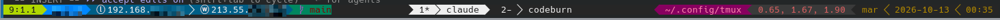

# tmux Configuration

My personal tmux configuration.



## Prerequisites

- tmux ≥ 3.0
- Any login shell (auto-detected via `$SHELL` — zsh, bash, etc.)
- `qdbus` for clipboard integration on KDE Plasma (part of `qdbus` / `qt5-tools`)

## Installation

### Quick install

Detects macOS (Homebrew) or Linux (apt, pacman, dnf, zypper, apk), installs the dependencies, then clones this repo, TPM and all plugins. Re-running it updates an existing install.

```bash
curl -fsSL https://raw.githubusercontent.com/furterg/tmux-config/main/install.sh | bash
```

### Manual install

#### 1. Clone this repo

```bash
git clone https://github.com/furterg/tmux-config.git ~/.config/tmux
```

> If you already have a `~/.config/tmux`, back it up first:
> `mv ~/.config/tmux ~/.config/tmux.bak`

#### 2. Install TPM (Tmux Plugin Manager)

TPM is installed directly into the XDG config directory:

```bash
git clone https://github.com/tmux-plugins/tpm ~/.config/tmux/plugins/tpm
```

#### 3. Install plugins

Start tmux, then press `Ctrl-a + I` (capital I) to install all plugins automatically.

## Plugins

| Plugin | Description |
|--------|-------------|
| [tpm](https://github.com/tmux-plugins/tpm) | Plugin manager |
| [tmux-sensible](https://github.com/tmux-plugins/tmux-sensible) | Sensible defaults |
| [tmux-resurrect](https://github.com/tmux-plugins/tmux-resurrect) | Save & restore sessions |
| [tmux-continuum](https://github.com/tmux-plugins/tmux-continuum) | Continuous session saving (every 5 min + on disconnect) |
| [tmux-yank](https://github.com/tmux-plugins/tmux-yank) | Clipboard integration |
| [tmux-powerline](https://github.com/erikw/tmux-powerline) | Powerline status bar |

## Session Persistence

Sessions are saved automatically every 5 minutes via tmux-continuum, and immediately when an SSH client disconnects. On tmux start, the last session is restored automatically.

Manual save: `Prefix + Ctrl-s`
Manual restore: `Prefix + Ctrl-r`

## Clipboard

Uses `klipper-copy.sh` to integrate with KDE Klipper via `qdbus`. Selections in copy mode are sent directly to the system clipboard.

## Key Bindings

| Key | Action |
|-----|--------|
| `Ctrl-a` | Prefix (replaces default `Ctrl-b`) |
| `Prefix + r` | Reload config |
| `Prefix + y` | Enter copy mode |
| `Prefix + L` | Switch to last window |
| `Prefix + h/j/k/l` | Navigate panes (vim-style) |
| `Prefix + I` | Install TPM plugins |

In copy mode (vi keys):
- `Enter` — copy selection to KDE Klipper clipboard
- Mouse drag — copy to KDE Klipper clipboard
